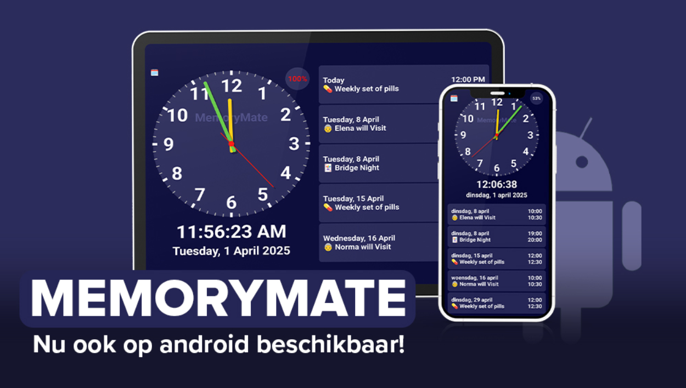
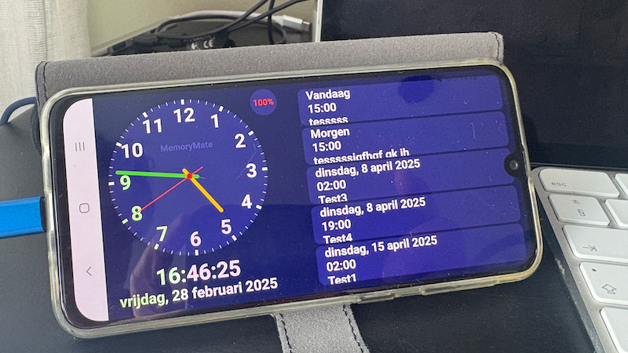

# MemoryMate for Android

**A free, simple calendar clock for seniors, people with dementia, young children and anyone who benefits
from a calm, easy-to-read display of the time and the day's appointments.**

[](https://github.com/erik-nie/MemoryMate-Android/actions/workflows/build.yml)
[](https://play.google.com/store/apps/details?id=com.eriknie.memorymate)

Website: <https://memorymate-android.merik2.workers.dev/> · Package: `com.eriknie.memorymate` · Current version: **2.0**



> 🇳🇱 **Nederlandse samenvatting:** MemoryMate is een gratis kalenderklok voor ouderen, mensen met dementie, jonge
> kinderen en mensen met een verstandelijke beperking. De app toont de tijd (analoog en digitaal) en de komende
> afspraken uit een gekozen agenda op het toestel. Zie [Nederlands](#nederlands) onderaan voor gebruik en bouwen.

## Features

- **Analog and digital clock** – three display modes: analog + digital, analog only, digital only.
  Double-tap the clock to switch.
- **Upcoming events** from any calendar on the device (Google, Outlook, shared calendars, …).
  Shows 3 to 10 events; double-tap the event area to cycle through the amount.
- **Large, high-contrast text**, adjustable with a text-scaling slider (50 % – 200 %).
- **Battery indicator** – while charging the screen stays on, so the device works as a bedside or table clock.
- **Portrait and landscape**, phones and tablets.
- **Follows the device language and region**, including right-to-left languages such as Arabic.
- **Private by design** – the app only needs permission to *read* your calendar, has no internet permission,
  and no data leaves the device.



## Requirements

- Android 8.0 (API 26) or later
- At least one calendar on the device (Settings → Accounts, or the Calendar app)

## How to use

1. Install MemoryMate from [Google Play](https://play.google.com/store/apps/details?id=com.eriknie.memorymate).
2. Allow access to your calendar when asked.
3. Tap the small calendar icon (top left) → **Change Calendar** and pick the calendar to show.
4. Double-tap the **clock** to change the display mode; double-tap the **events** to change how many are shown.
5. Optional: adjust **Text Scaling** in the same settings dialog.

## Build from source

You need **JDK 21** and the **Android SDK** (Android Studio installs both).

```bash
git clone https://github.com/erik-nie/MemoryMate-Android.git
cd MemoryMate-Android
./gradlew assembleDebug          # debug APK  -> app/build/outputs/apk/debug/
./gradlew lintDebug              # lint report -> app/build/reports/
```

Or open the folder in Android Studio and press *Run*. Gradle needs `ANDROID_HOME` (or a `local.properties`
file with `sdk.dir=...`) to find the SDK.

### Signed release bundle (for Google Play)

The release build reads the signing details from environment variables, so no secrets live in the repository:

```bash
export MM_KEYSTORE=/path/to/upload.jks
export MM_KEY_ALIAS=your-alias
export MM_STORE_PASSWORD=...
export MM_KEY_PASSWORD=...
./gradlew bundleRelease          # -> app/build/outputs/bundle/release/app-release.aab
```

Without these variables `bundleRelease` still works, but produces an **unsigned** bundle.

## Continuous integration and releasing

Two GitHub Actions workflows live in [`.github/workflows`](.github/workflows):

| Workflow | Trigger | What it does |
|---|---|---|
| [`build.yml`](.github/workflows/build.yml) | every push to `main` and every pull request | builds the debug APK, runs lint and unit tests, uploads the APK and lint report as artifacts |
| [`release.yml`](.github/workflows/release.yml) | push of a tag `v*`, or manually (*Actions → Release → Run workflow*) | builds and signs the release `.aab`, uploads it to Google Play, and attaches it to a GitHub release |

### Repository secrets

Add these under *Settings → Secrets and variables → Actions*:

| Secret | Contents |
|---|---|
| `KEYSTORE_BASE64` | the upload keystore, base64-encoded: `base64 -i upload.jks \| pbcopy` |
| `KEYSTORE_PASSWORD` | keystore password |
| `KEY_ALIAS` | key alias in the keystore |
| `KEY_PASSWORD` | key password |
| `PLAY_SERVICE_ACCOUNT_JSON` | *(optional)* full JSON of a Google Cloud service account with release access to the app. Without it the workflow still builds and signs, but skips the Play upload. |

<details>
<summary>How to create the Play Store service account</summary>

1. In [Google Cloud Console](https://console.cloud.google.com/) create (or pick) a project and enable the
   **Google Play Android Developer API**.
2. Create a **service account**, then create a **JSON key** for it and download it.
3. In [Play Console](https://play.google.com/console) → *Users and permissions* → *Invite new users*, add the
   service account's e-mail address and give it permission to **release apps** for MemoryMate.
4. Paste the contents of the JSON file into the `PLAY_SERVICE_ACCOUNT_JSON` secret.

</details>

### Publishing a new version

1. In [`app/build.gradle.kts`](app/build.gradle.kts) raise `versionCode` (must always increase) and set `versionName`.
2. Update the release notes in [`distribution/whatsnew`](distribution/whatsnew) (max. 500 characters per language).
3. Commit, then tag and push:

   ```bash
   git tag v2.1
   git push origin v2.1
   ```

   The workflow checks that the tag matches `versionName`, builds and signs the bundle, and uploads it to the
   **internal testing** track.
4. Test the build from the Play Store on your own device, then promote it to production in Play Console, or run
   the *Release* workflow manually and choose the `production` track.

> **Note:** Google requires apps to be registered for Android developer verification (and a recent `targetSdk`).
> Check the status on the Play Console home page before releasing.

## Project structure

```
app/src/main/java/com/eriknie/memorymate/MainActivity.kt   # whole UI: clock, calendar list, settings dialog
app/src/main/AndroidManifest.xml                           # only the READ_CALENDAR permission
app/build.gradle.kts                                       # version, SDK levels, signing via environment variables
gradle/libs.versions.toml                                  # dependency versions
distribution/whatsnew/                                     # Play Store release notes
.github/workflows/                                         # CI and release automation
```

Built with Kotlin and Jetpack Compose (Material 3).

---

## Nederlands

**MemoryMate** is een gratis kalenderklok die eenvoudig te gebruiken is voor ouderen, mensen met dementie, jonge
kinderen en mensen met een verstandelijke beperking. Je ziet de huidige tijd (analoog en digitaal) en de komende
afspraken uit een agenda die op het toestel staat, ook een gedeelde of Google/Outlook-agenda.

### Gebruik

1. Installeer de app via [Google Play](https://play.google.com/store/apps/details?id=com.eriknie.memorymate) en geef toegang tot de agenda.
2. Tik op het kleine agenda-icoon (linksboven) → **Change Calendar** en kies je agenda.
3. **Dubbel tikken op de klok** wisselt tussen analoog + digitaal, alleen analoog en alleen digitaal.
4. **Dubbel tikken op de afspraken** wisselt het aantal getoonde afspraken (3 tot 10).
5. De tekstgrootte stel je in met de schuifregelaar **Text Scaling**.

Tijdens het opladen blijft het scherm aan, zodat het toestel als tafelklok kan dienen. De app gebruikt de taal en
regio van het toestel en vraagt alleen toestemming om de agenda te *lezen*; er wordt niets verstuurd.

### Bouwen en uitbrengen

De uitleg hierboven geldt ook voor Nederlandse gebruikers: lokaal bouwen met `./gradlew assembleDebug`, en een
nieuwe versie uitbrengen door `versionCode`/`versionName` te verhogen, een tag `vX.Y` te pushen en de
GitHub Actions-workflow de ondertekende bundle naar Google Play te laten sturen. De benodigde secrets staan in
de tabel onder *Repository secrets*.

## Contact

Questions or ideas? Open an [issue](https://github.com/erik-nie/MemoryMate-Android/issues) or visit the
[website](https://memorymate-android.merik2.workers.dev/).
